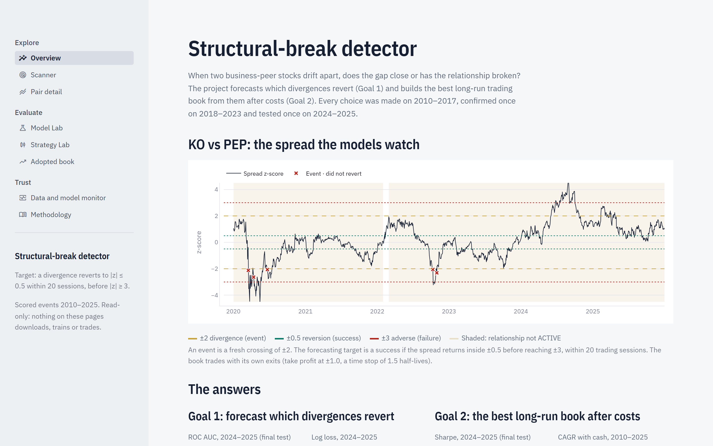
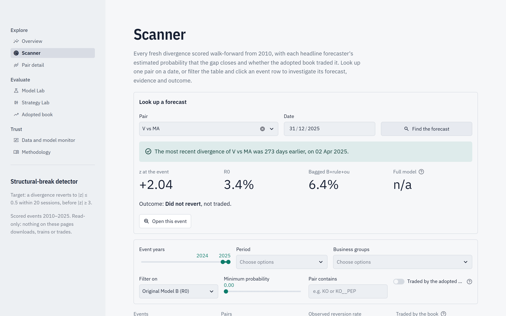
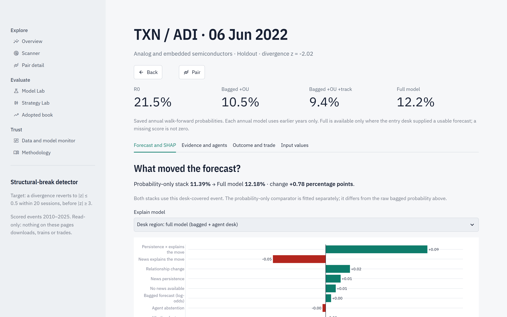
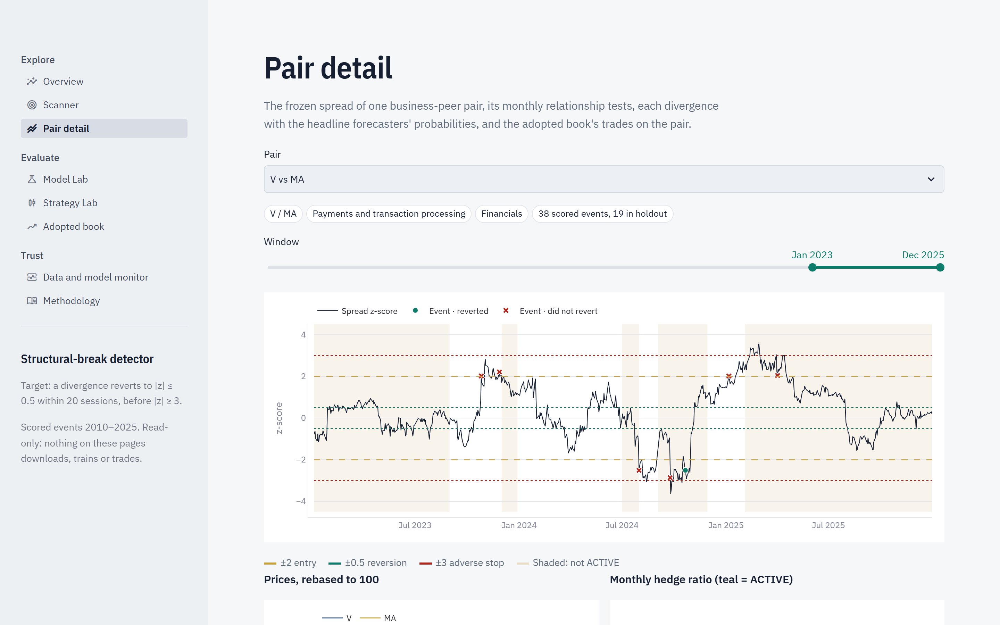
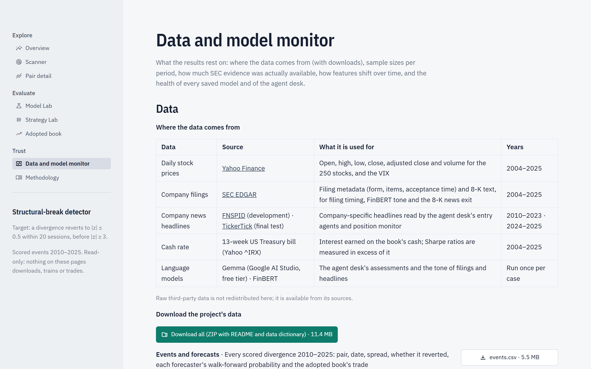

# Structural-break detector

When two business-peer stocks drift apart, does the gap close, or has the relationship
broken? This project forecasts which divergences between 736 pairs of large US stocks revert
(Goal 1) and trades a book on the forecasts after realistic costs (Goal 2). Every choice was
made on 2010–2017, confirmed on 2018–2023 and tested once on the locked 2024–2025 data.

**App:** <https://projectaiinfinance-mkt.streamlit.app> · read-only, no login, nothing to install.



FINS5557 Applied AI in Finance, group project (Track A). AI coding assistants were used to
build it; see [AI tool use](#ai-tool-use).

## Results in brief

| Goal | Result on the final test, 2024–2025 |
|---|---|
| 1. Forecast reversion | Met. The pre-registered bagged XGBoost model has ROC AUC 0.742 against 0.719 for the original Model B (R0) and 0.720 for the price-only Model A, with lower log loss and Brier score. |
| 2. Best book after costs | Not met. The adopted book's Sharpe ratio is −0.17 (0.77 on 2010–2023). The overfitting audit had warned of this (deflated Sharpe ratio 0.86, probability of backtest overfitting 0.54). |
| Agent desk | The language-model agents cite the news correctly but add no forecasting power; only their monitor exit is used by the book. |

## How it works

1. **Pairs and events (econometrics).** Each month every pair's log prices are regressed on
   each other over two years and tested for cointegration (Engle–Granger). The spread's
   z-score is frozen for the month; a fresh crossing of |z| = 2 is an *event*, which
   *reverts* if |z| falls to 0.5 within 20 sessions before reaching 3.
2. **Forecasters (machine learning).** XGBoost classifiers, trained walk-forward (each year
   on earlier years only) and calibrated: Model A (prices only), Model B (R0, plus SEC
   filing timing and FinBERT tone), and the bagged B+rule+ou model (plus peer, earnings,
   momentum and Ornstein–Uhlenbeck inputs, five seeds averaged).
3. **Agent desk (language models).** A pair news analyst, a bull/bear debate and a risk
   judge (Gemma and Gemini on the free Google AI Studio tier) score each event's news with
   cited sentences; a position monitor can close a trade when the news turns against it.
4. **Trading book.** R0's top 20 % of events each year, entry filters, take profit at
   |z| ≤ 1, a half-life time stop, news and monitor exits, per-stock costs at $10m, a
   residual-reversal sleeve, a volatility target and interest on cash.
5. **App.** A Streamlit app that reads the checksummed outputs of the steps above.

The design and every result are in [FORECASTING_AND_BOOK.md](docs/FORECASTING_AND_BOOK.md),
[AGENT_DESK.md](docs/AGENT_DESK.md) and the pre-registered [decision log](docs/DECISIONS.md).

## Features

| Page | What you can do |
|---|---|
| Overview | The question, a live example spread (KO vs PEP) and the headline answers to both goals |
| Scanner | Look up any pair's forecast on a date; filter all 26,177 scored divergences by year, period, business group, model probability and trade |
| Pair detail | A pair's spread, prices and monthly hedge ratio for 2010–2025, with its events, forecasts and trades |
| Event investigation | One forecast explained with SHAP values; for 2024–2025 events, a live re-score with the saved bagged models and a what-if on the inputs that moved it; the filings and news available at the close, the agents' assessments and the outcome and trade |
| Model Lab | The forecasters compared on ROC AUC, PR AUC, log loss and Brier score per period, with ROC, precision-recall and calibration curves |
| Strategy Lab | The adopted book against its variants (without the monitor, the bagged forecaster's selection, the full model's selection) |
| Adopted book | The book's value, drawdowns, trades and exit reasons, by period |
| Data and model monitor | Where the data comes from, CSV and ZIP downloads with a data dictionary, sample sizes, SEC coverage and feature drift |
| Methodology | The method in plain language |

The app verifies the SHA-256 checksum of every data file before it shows anything, and shows
a plain error instead of unverified data.

## Using the app

**Look up a forecast.** On *Scanner*, choose a pair (type a ticker, e.g. `V`), pick a date
and press *Find the forecast*. For V vs MA on 31/12/2025 the app finds the divergence of
2 April 2025: z = +2.04, R0 3.4 %, bagged model 6.4 %, which did not revert and was not
traded. *Open this event* goes to its investigation. A date outside 2010–2025, or before the
pair's first event, gets a message instead of a result.



**Investigate an event.** The TXN vs ADI divergence of 6 June 2022 had R0 21.5 %, bagged
10.5 % and full model 12.2 %. The *Forecast and SHAP* tab shows which inputs moved the
forecast; *Evidence and agents* shows the news analyst's scores (here 1 of 5 on all three:
the news did not explain the move).



**Score an event live.** On a 2024–2025 event, the *Live model* tab re-scores it with the
five saved bagged models (about 40 ms) and shows that the result matches the published
forecast. Below, the four inputs that moved the forecast most can be changed and scored
again: for V vs MA on 2 April 2025, raising *Market share diverged* from 0.152 to 0.275
lifts the probability from 6.36 % to 8.70 %.

**Follow a pair.** *Pair detail* for V vs MA shows the spread with the ±2 entry, ±0.5
reversion and ±3 failure bands, every event coloured by outcome, and the book's trades.



**Download the data.** *Data and model monitor* offers each dataset as CSV (events and
forecasts, model inputs, trades, daily book values, metrics, news coverage) and one ZIP with
a README and a data dictionary. Raw third-party data is described with its source, not
redistributed.



## Installation

The app needs Python 3.11 and runs on the data committed in `demo/` (about 140 MB); no keys
or downloads are needed.

With [uv](https://docs.astral.sh/uv/) (recommended, uses the locked versions in `uv.lock`):

```shell
git clone https://github.com/MariusPoulsen/Project_AI_in_Finance.git
cd Project_AI_in_Finance
uv python install 3.11
uv sync --frozen
uv run --frozen streamlit run app/research_app.py
```

With pip:

```shell
python -m venv .venv
.venv\Scripts\activate          # macOS/Linux: source .venv/bin/activate
pip install -r requirements.txt
streamlit run app/research_app.py
```

Then open <http://localhost:8501>. The first start takes a few seconds while the data are
verified.

### Dependencies

`requirements.txt` is exported from `uv.lock` and pins every package. The main ones are
Streamlit and Plotly (app), pandas and PyArrow (data), statsmodels (cointegration tests),
scikit-learn and XGBoost (forecasters) and SHAP (explanations). `pyproject.toml` lists the
direct dependencies, which are all the app needs. The optional extras are only for
rebuilding the research: `nlp` (PyTorch and Transformers for FinBERT), `agents` (the
agent-desk tooling) and `research` (LightGBM, CatBoost and Optuna for the comparisons).

### API keys (only to rebuild the research)

The deployed app needs no keys. Rebuilding the data and the agent desk needs two values,
which are read from a `.env` file that git ignores:

```shell
cp .env.example .env    # then fill in the values; never commit .env
```

| Variable | What it is |
|---|---|
| `SB_LLM_API_KEY` | A free Google AI Studio key for the Gemma agent desk |
| `SB_SEC_USER_AGENT` | Your project name and contact email, which SEC EDGAR asks for (not a key) |

Keys are never written to code, configuration, logs or command lines.

## Rebuilding the research

The study is reproducible from source, but it takes days of compute and the free API tier.
[RESEARCH_RUNBOOK.md](docs/RESEARCH_RUNBOOK.md) covers data capture and the registry,
[FORECASTING_AND_BOOK.md](docs/FORECASTING_AND_BOOK.md#rebuilding-the-inputs-and-checking-the-book)
the forecasters and the book, [AGENT_DESK.md](docs/AGENT_DESK.md#code-and-commands) the
agents, and [FINAL_TEST_RUNBOOK.md](docs/FINAL_TEST_RUNBOOK.md) the single 2024–2025 run.
`scripts/export_results.py` writes the app's `demo/results`.

## Development

```shell
uv sync --frozen --extra agents
uv run --frozen --extra agents ruff check .
uv run --frozen --extra agents ruff format --check .
uv run --frozen --extra agents mypy
uv run --frozen --extra agents pytest
```

CI runs these on Windows and Linux for every pull request. Tests use offline fixtures and
cannot reach the network.

## Known issues

- **The trading edge did not hold.** The book's 2010–2023 Sharpe ratio of 0.77 fell to
  −0.17 on the final test. The app is a forecasting and research tool, not trading advice.
- **News sources differ.** 2010–2023 uses FNSPID headlines and 2024–2025 TickerTick, which
  has far more headlines per company; the monitor exit fired on 17.6 % of final-test trades
  against about 5 % before.
- **Survivorship.** The 250 companies are today's large caps, and the business groups use
  today's classifications.
- **Static data.** The app shows the frozen study and does not update with new prices.
- **Explanations show the largest effects.** Each event's SHAP chart shows its 15 largest
  input effects (averaged over the bag's models) and sums the rest in one bar.
- **Cold start.** After a period without visitors, Streamlit Community Cloud puts the app to
  sleep; the first visit then takes a little longer.

## Planned enhancements

- A daily job that scores new divergences with the frozen models.
- One consistent news source for all years before the monitor is trusted further.
- A larger universe, which the residual-reversal results suggest is the main lever for the book.

## AI tool use

Claude Code (Anthropic) co-wrote most of the code, under a pre-registered decision log,
tests and CI; OpenAI Codex contributed the SHAP and event-investigation exports. All research
decisions and the acceptance of every result were the team's. Inside the system, Gemma and
Gemini (Google AI Studio, free tier) run the agent desk and FinBERT scores sentence tone.

## Repository layout

| Path | Contents |
|---|---|
| `app/research_app.py` | App entry point |
| `src/structural_break/` | Source: `econometrics`, `ml`, `forecast`, `book`, `agents`, `pipeline`, `app_ui` and more |
| `demo/` | The verified data the app reads: `results`, `pair_history`, `app_bundle` |
| `scripts/` | Exports, the final-test steps, figures and checks |
| `docs/` | Design, decision log, runbooks and screenshots |
| `tests/` | Unit and integration tests |
