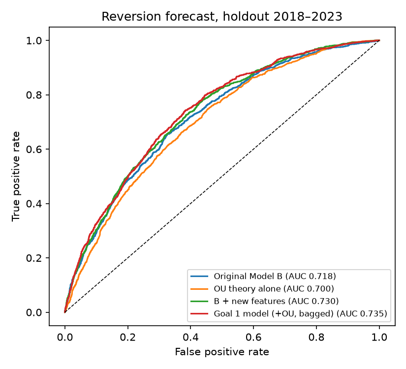
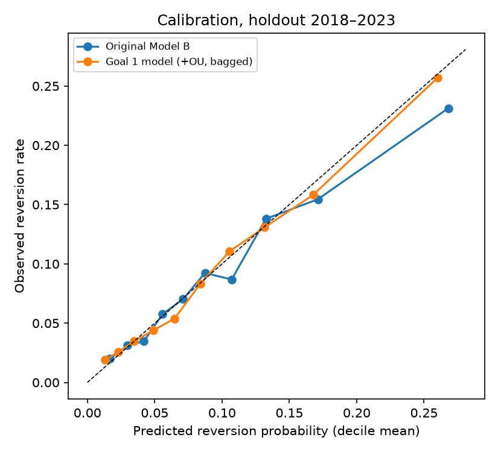
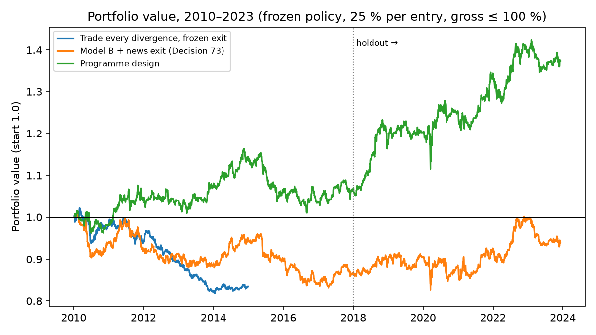

# Quant research programme (workstream 1)

Branch `p6/quant-research`. Pre-registrations and results:
[DECISIONS 75–91](DECISIONS.md). The 2024–2025 final test stays locked, and
nothing here changes the frozen Decision 36–42 policies or the accepted v2
snapshot.

**Overfitting control.**
- **Choices:** every choice was made on the 2010–2017 walk-forward test years.
- **Confirmation:** 2018–2023 was opened once per stage, only after the
  choice was committed.
- **Rejections:** four choices that looked good on 2010–2017 did **not**
  hold out and were rejected: the extra feature block, a wider take profit,
  the cointegration block on the final model, and a recalibration scheme
  that never got past selection.
- **Holdout reuse:** the holdout has been opened in about ten stages, so its
  later results are less clean than its first. The 2024–2025 final test is
  the clean test.

## Goal 1: forecasting mean reversion

The target is whether a divergence (|z| ≥ 2) reverts to |z| ≤ 0.5 within 20
sessions before |z| ≥ 3. The base rate is 5.6 % in 2010–2017 and about 10 %
in 2018–2023.

New point-in-time inputs (`p6_quant_features`, `p6_quant_ou`):

| Block | Contents |
|---|---|
| peer | Each stock's displacement against all its other peers; share of its other pairs diverging; market-wide divergence breadth (Chen et al. 2019; Avellaneda & Lee 2010) |
| state | Zero crossings over 252 days, AR(1) rho, error-correction speed, relationship age |
| earnings | Days since and estimated days to each leg's next earnings 8-K; next earnings inside the holding window |
| momentum | Each leg's 20/120-session return aligned with the divergence; distance to the 252-session high |
| ou | Structural Ornstein–Uhlenbeck Monte Carlo from the pair's AR(1) persistence and realised z volatility: probability of the label, probability of the take profit, expected z captured, implied expected return |
| track | Pair and stock reversion record on earlier resolved events (best observed out of sample; not chosen by the rules) |

**Method comparison** (the same 11,048 and 10,940 labelled events in every
row):

| Model | AUC 2010–17 | AUC 2018–23 | PR-AUC 2018–23 | Log loss 2018–23 | Brier 2018–23 |
|---|---|---|---|---|---|
| Model A (prices only) | 0.684 | 0.711 | 0.204 | 0.2836 | 0.0791 |
| OU theory alone (econometric, calibrated) | 0.716 | 0.700 | 0.175 | 0.2875 | 0.0802 |
| Original Model B (Decision 45 XGBoost) | 0.692 | 0.718 | 0.207 | 0.2832 | 0.0790 |
| Model B, recent training scheme | 0.700 | 0.717 | 0.206 | 0.2829 | 0.0789 |
| B + peer, state, earnings, momentum | 0.716 | 0.730 | 0.214 | 0.2799 | 0.0785 |
| + OU block | 0.735 | 0.733 | 0.216 | 0.2784 | 0.0782 |
| **+ seed bagging (pre-registered Goal 1 model)** | **0.743** | **0.735** | **0.217** | **0.2780** | **0.0781** |
| + track block (best observed, post-hoc) | 0.745 | 0.739 | 0.222 | 0.2765 | 0.0777 |

**Against the original Model B on 2018–2023** (month-block bootstrap):

| Model | Log-loss gain | 95 % | p | AUC gain | p |
|---|---|---|---|---|---|
| Pre-registered Goal 1 model | +0.0053 | — | 0.002 | +0.017 | — |
| B+rule step | +0.0034 | [+0.0005, +0.0062] | 0.007 | +0.012 | 0.002 |




**Findings for the report.**
1. **New information is what helps.** Peer displacement, the earnings
   calendar, momentum and the structural OU prior improve the forecast.
   Tuning, other boosting libraries and the training scheme do not
   (Decisions 66, 70).
2. **A pure econometric model is competitive.** The OU model alone matches
   the original ML model on 2010–2017 but is weaker on 2018–2023. It is most
   useful as an input to the ML model.
3. **Feature subsampling and seed bagging help** once the input set is
   wide (about 170 features).

## Goal 2: the best portfolio

**Better reversion forecasts did not select better trades.** Profit is
roughly probability × payoff scale − costs. The best forecasters
concentrate on tight spreads, whose reversions are small relative to fixed
costs (Decision 87).
- **Tried and failed:** seven alternative selections, including expected-
  value rankings, return regression, OU ranking and the better forecasters.
- **What worked:** the simple original-Model-B top 20 % stayed the most
  robust selection. The gains came from how trades are run.

| Component | Choice | Evidence |
|---|---|---|
| Selection | Original Model B, top 20 % by previous-year cutoff | Seven alternatives failed (Decisions 79a, 85a, 86a, 87a) |
| Entry filter 1 | Skip if the moving company filed earnings in the last 3 sessions or has negative recent news (R1) | Best 2010–2017 portfolio Sharpe (Decision 82a) |
| Entry filter 2 | Skip if the spread has not crossed its mean for more than 120 sessions (a broken relationship) | Decision 89 |
| Take profit | \|z\| ≤ 1.0 (frozen: 0.5) | 36-variant exit grid, confirmed on 2018–2023 (Decision 77); a wider 1.5 failed its holdout (Decision 83b) |
| Adverse stop | Disaster stop at \|z\| ≥ 5 (frozen: 3) | Stops at 3 cut profits; the disaster stop limits the tail (Decision 80a) |
| News exit | E3 adverse-tone exit | Decision 60 |
| Time stop | 20 sessions | 10 was worse in every comparison |

**Portfolio, 2010–2023** (frozen portfolio policy: start NAV 1, 25 % of NAV
per entry, gross ≤ 100 % of NAV, frozen costs and borrow):

| Design | CAGR | Volatility | Sharpe | Max drawdown | Total return |
|---|---|---|---|---|---|
| Trade every divergence, frozen exit (original) | −3.6 % | 4.1 % | −0.86 | −20.0 % | NAV 0.84 by 2014 |
| Model B, news exit (Decision 73 candidate) | −0.5 % | 5.4 % | −0.06 | −18.7 % | −6 % |
| Programme design without the broken-relationship filter | +2.25 % | 5.8 % | 0.41 | −13.8 % | +36 % |
| **Programme design** | **+2.31 %** | 5.8 % | **0.42** | **−13.2 %** | **+37 %** |
| Programme design, 10 % per entry | +2.2 % | 4.4 % | 0.52 | −11.3 % | — |



**Uncertainty.**
- **Sharpe:** the programme design's monthly Sharpe over 2010–2023 is 0.46,
  95 % [−0.06, 1.00] from 5,000 month resamples; P(Sharpe ≤ 0) = 0.048.
- **Months:** 57 % of its 168 months are positive.

**Sensitivities** (the design without the second filter, 25 % per entry,
2010–2023; reported, not used for any choice):

| Scenario | CAGR | Sharpe | Max drawdown |
|---|---|---|---|
| Costs 2.5 bps per side | +3.0 % | 0.54 | −12.5 % |
| Frozen (5 bps per side, 1 % borrow) | +2.25 % | 0.41 | −13.8 % |
| Costs 10 bps per side | +0.8 % | 0.16 | −16.3 % |
| Borrow 2 % | +1.8 % | 0.34 | −14.5 % |
| Gross cap 150 % (37.5 % per entry) | +3.2 % | 0.41 | −20.4 % |
| Gross cap 200 % (50 % per entry, no financing cost) | +4.1 % | 0.41 | −26.9 % |

**Caveats.**
- **Costs:** the edge is thin relative to costs. At double the frozen costs
  the design is only marginally positive.
- **Leverage:** the Sharpe of about 0.4–0.5 is modest. Leverage scales
  return and drawdown together.
- **Concentration in time:** most of the profit comes from 2018–2023. In
  the portfolio, 2010–2017 is only mildly positive.
- **Reuse of years:** every year here has been used during development.
  The 2024–2025 final test is the test.

## Running

```powershell
# features and forecast specs (selection years; add --holdout to confirm)
.venv\Scripts\python.exe -m structural_break.experiments.p6_quant run --specs B+rule+ou --schemes recent:bag5
.venv\Scripts\python.exe -m structural_break.experiments.p6_quant summary
# exit grid (all events, 36 exits, checked against the frozen simulator)
.venv\Scripts\python.exe -m structural_break.experiments.p6_quant_trading build
.venv\Scripts\python.exe -m structural_break.experiments.p6_quant_trading explore-exits
# portfolios from a designs JSON
.venv\Scripts\python.exe -m structural_break.experiments.p6_quant_portfolio --designs outputs\p6_quant\designs_h.json
```
